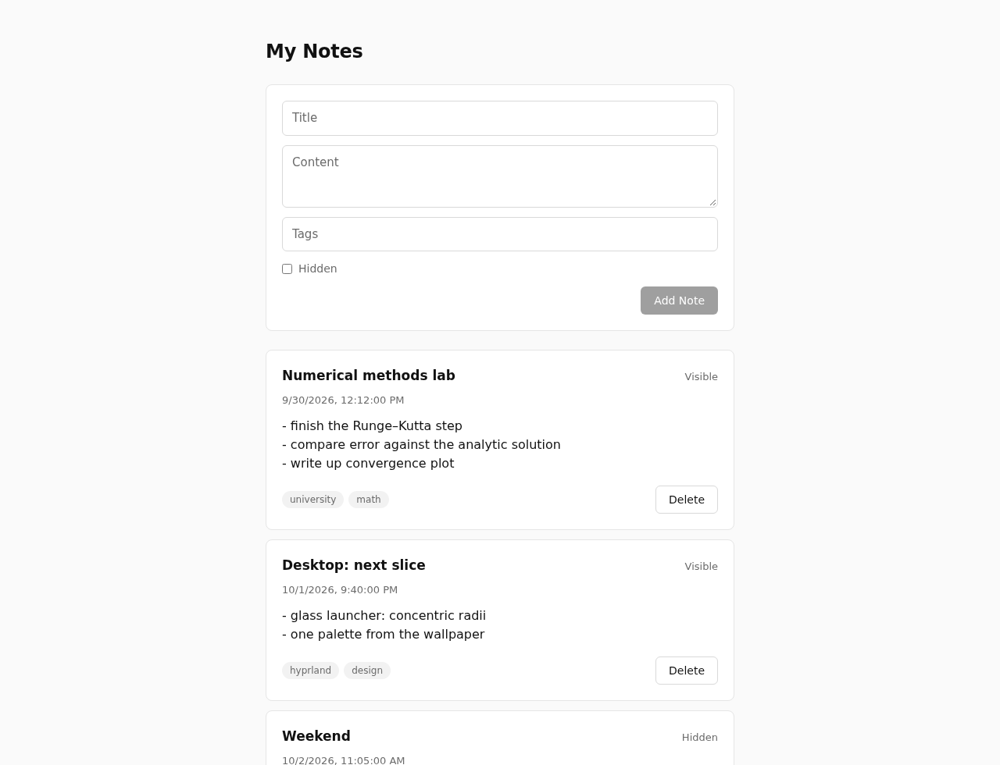

# notes

A small notes app in React 19 and TypeScript. Write a note, tag it, hide it, find it again with search, tag and sort filters, delete it — all against a local REST API served by json-server.



## Features

- Create notes with a title, content and up to five comma-separated tags
- Mark a note as hidden; every card shows whether it is visible
- All filtering happens on the server, in one `_where` query: search by title, hide hidden notes, filter by tags with toggle chips (a note shows if it has any of the selected tags), sort by creation date newest or oldest first (`_sort`)
- Tag chips list every tag in the database, not only the tags of the notes currently shown
- An empty-state message when nothing matches
- After creating or deleting a note the list refetches with the active filters, then the tag list reloads; responses for an outdated query are ignored
- Form state and validation on `react-hook-form`
- Dates and tags change shape at the edge (`mapNoteFromDTO` / `mapNoteToDTO` in `src/utils.ts`): dates travel as ISO strings, tags as one string

## Run it

Two processes: the API and the dev server.

```bash
npm install
npm run db    # json-server on http://localhost:3000, data in db.json
npm run dev   # Vite on http://localhost:5173
```

## How filtering works

### Tags are stored as a string

json-server can't search inside arrays, so in `db.json` `tags` is a string with commas around every tag: `",school,algebra,"`, or `""` when there are none. The edge commas let a search for `,eat,` find `eat` without also finding `great`.

In the app `tags` is a `string[]`. The mappers convert between the two:

- `mapNoteFromDTO` — `split(',')`, trim, drop empty strings
- `mapNoteToDTO` — `join(',')` wrapped in commas, or `""` for no tags

### Building the query

```ts
interface NoteQuery {
  where: Record<string, unknown>
  sort?: string
}
type NoteFilter = Record<string, (query: NoteQuery) => void>
```

The `filters` state in `App` is an object of functions. `NoteFilterForm` replaces one by key, and each writes its own piece of the query:

| key      | writes                                                  |
| -------- | ------------------------------------------------------- |
| `search` | `where.title = { contains: value }` (if not empty)      |
| `hidden` | `where.hidden = { eq: false }`, or deletes it           |
| `sort`   | `sort = '-createdAt'` or `'createdAt'` (default newest) |

`buildQueryString(filters, tags)` calls every function on an empty query, adds the tags as `where.or = [{ tags: { contains: ',tag,' } }, …]` (any of them matches), then puts `JSON.stringify(where)` into `_where` and `sort` into `_sort`.

Search for "buy", tags `school` and `eat`, newest first (shown decoded; `URLSearchParams` encodes it):

```
GET /notes?_where={"title":{"contains":"buy"},"or":[{"tags":{"contains":",school,"}},{"tags":{"contains":",eat,"}}]}&_sort=-createdAt
```

### Tag chips

`fetchAllTags()` makes a separate `GET /notes` without filters and collects the unique tags. Taking tags from the filtered notes would make the unselected ones disappear. `availableTags` is state: loaded on mount and again after every create or delete.

`activeTags` are the selected tags that are still in `availableTags`. Only they go into the query, so deleting the last note with a selected tag doesn't leave a filter you can't see or turn off.

### Loading

`queryString` is computed during render, and the fetch effect depends on `[queryString]`. A string compares by value, so a re-render with the same filters doesn't fetch again. After `POST` or `DELETE` the app fetches `GET /notes${queryString}` again, then `fetchAllTags()`.

### json-server 1.0.0-beta.15 quirks

- `_where` fully replaces the plain filter params (`title:contains=…`, `hidden=false`); `_sort`, `_page`, `_per_page`, `_embed` work alongside it. Invalid JSON in `_where` is ignored and the plain params are used.
- Inside `_where` the operator is required: `{"hidden":{"eq":false}}`. A bare `{"hidden":false}` matches no records at all.
- An unknown operator (`{"title":{"like":"x"}}`) is silently ignored — the condition lets everything through.
- An empty `or` lets nothing through, so `or` is added only when tags are selected.
- `contains` is case-insensitive.

## Stack

React 19 · TypeScript · Vite · react-hook-form · json-server · CSS Modules · ESLint · Prettier

## Layout

```
src/
  components/
    App.tsx              fetch, create, delete; filter state, query building, tag list
    CreateNoteForm.tsx   the form and its validation
    NoteFilterForm.tsx   search, show-hidden, sort and tag chips
    NoteCard.tsx         one note
    Button.tsx           shared button
  styles/                CSS Modules, one per component, plus global index.css
  types.ts               Note, its wire format NoteDTO, NoteQuery and NoteFilter
  utils.ts               DTO ↔ model mapping, including tags string ↔ array
```
